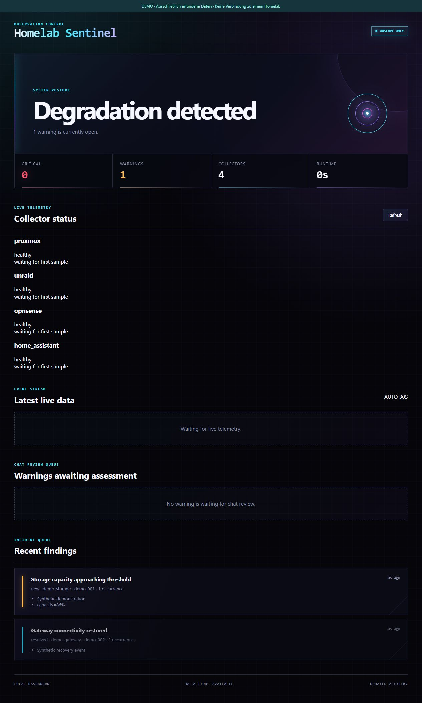
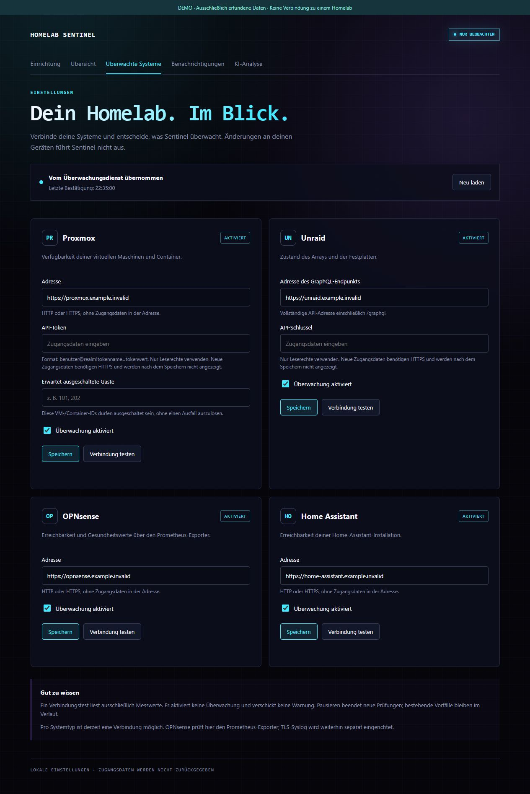
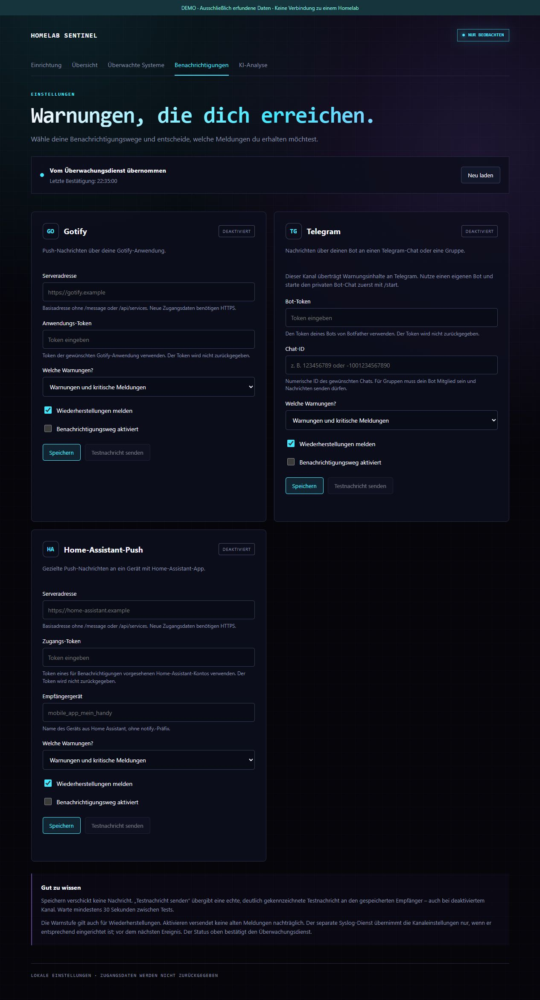

# Homelab monitoring project — working title

> **Name noch offen / name pending:** "Homelab Sentinel" ist nur der bisherige
> Arbeitstitel, kein endgueltiger Produktname. Die Namensfindung laeuft.
> Vorhandene Repository-URLs und Demo-Screenshots verwenden noch den alten
> Arbeitstitel; daraus folgt keine Markenfreigabe.

**Dein Homelab. Im Blick.**

Sentinel beobachtet Server, Speicher, Firewall, Backups und Smart Home. Feste Regeln
erkennen bekannte Fehler, fassen Ereignisse zu Vorfaellen zusammen und melden
sie per Gotify, Telegram oder Home Assistant. Eine optionale KI-Analyse kann
zusaetzlichen Kontext liefern. Das Projekt befindet sich in Entwicklung.

Der aktuelle Hauptzweig umfasst unter anderem herstellerneutrale
Backup-Frische, einen externen Dead-Man-Check und zeitlich begrenzte
Wartungsfenster. Ein streng begrenzter lokaler CLI-Incident-Analyst fuer Codex,
Claude oder kompatible Werkzeuge befindet sich im Review. Er darf Vorfaelle
einordnen und manuelle Pruefungen vorschlagen, aber keine Systeme veraendern.

Die Praesentationsseite trennt klar zwischen vorhandenen Funktionen, aktuell
geprueften Implementierungen und Roadmap-Ideen. Der Stand ist keine Aussage
ueber einen produktiven Rollout.

## Projekt ansehen

**[Zur Praesentationsseite](https://h4rbingerr.github.io/Homelab-Sentinel-Showcase/)**

Ueberwachte Systeme

Benachrichtigungen inklusive Telegram

## Zugang und Projektstatus

Dieses Repository enthaelt ausschliesslich die statische Projektvorstellung und
Demoaufnahmen. Alle abgebildeten Daten sind erfunden. Es gibt keine Verbindung
zu einer produktiven Installation und hier keinen Anwendungscode oder Installer.

Der Quellcode von Homelab Sentinel bleibt vorerst privat; Mitarbeit dort erfolgt
auf Einladung. Oeffentliche Besucher erhalten durch diese Praesentation keinen
Schreibzugriff auf das Anwendungsrepository. Die Praesentationsdateien koennen
wie jede oeffentliche Webseite angesehen und kopiert werden.

Stand: Oktober 2026.
